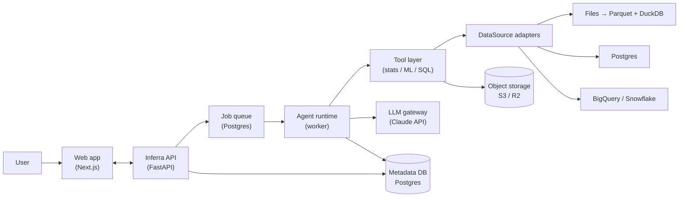
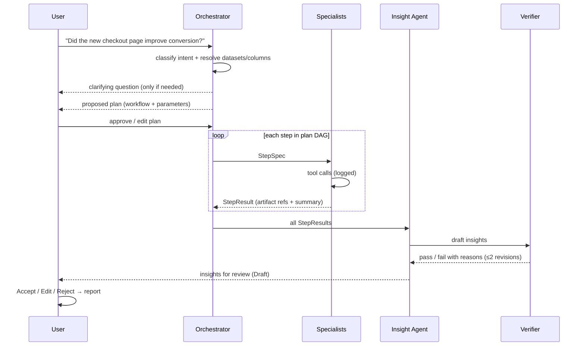
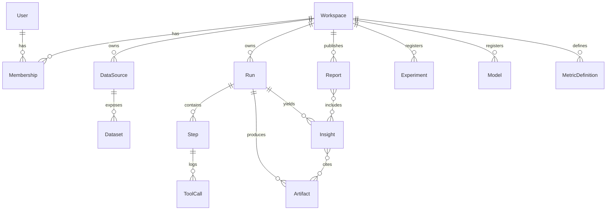

# Inferra — Architecture

This document describes how Inferra turns a natural-language goal into verified, reviewable data work using a small team of collaborating agents.

The guiding constraint: **multi-agent, but boring to reason about.** Every design choice below favors a structure that a new engineer can hold in their head.

## 1. Design principles

1. **Workflows are templates, not improvisation.** The planner picks and adapts a predefined workflow for the user's intent. It does not invent arbitrary pipelines.
2. **Hub and spoke.** Only the Orchestrator talks to specialist agents. Specialists never call each other.
3. **Agents share state through artifacts, not chat.** Every step reads and writes typed artifacts (tables, results, models) in a run-scoped store.
4. **LLMs reason; tools compute.** No number shown to a user is produced by a language model. Numbers come from deterministic tools (DuckDB, pandas, scipy, statsmodels, scikit-learn).
5. **Everything is reproducible.** Every tool call is logged with its inputs, code/SQL, and outputs, so any result can be re-run and audited.
6. **Humans review at fixed checkpoints.** Clarification, plan approval, and insight review. Nothing else blocks on a human.

## 2. System overview



Two deployables plus managed services:

| Component | Tech | Responsibility |
|---|---|---|
| `apps/web` | Next.js, TypeScript, Tailwind | UI only: goal input, plan review, live run view, insight review, dataset profiles. `/api/*` is proxied to the API so session cookies stay first-party |
| `services/api` | Python, FastAPI | REST + SSE API, auth, metadata, agent runtime (worker process), tool layer |
| Metadata DB | Postgres (Neon) | Workspaces, datasets, runs, steps, artifacts, insights, registries; also the job queue |
| Object storage | S3-compatible (Cloudflare R2; local disk in dev) | Uploaded files (normalized to Parquet), large artifacts, model binaries |
| LLM | Claude API via a thin gateway | Planning, tool selection, interpretation, narrative |

The API and the worker are the same Python codebase started in two modes (`api`, `worker`). This keeps the agent runtime next to the statistical and ML libraries it drives.

## 3. The agent team

Six roles. Each specialist is just **a system prompt + an allowed tool set + a step contract.** No agent framework is required to understand them.

| Agent | Role | Example tools |
|---|---|---|
| **Orchestrator** | Understands the goal, asks clarifying questions, instantiates a workflow, dispatches steps, re-plans on failure | `classify_intent`, `list_datasets`, `instantiate_workflow` |
| **Data Agent** | Finds and prepares data: schema discovery, profiling, joins, cleaning, SQL, semantic and dimensional modeling | `profile_dataset`, `run_sql` (read-only), `suggest_join_keys`, `propose_star_schema` |
| **Analyst Agent** | Descriptive and diagnostic analysis plus statistical modeling | `compute_metric`, `segment_breakdown`, `funnel`, `retention`, `decompose_metric_change`, `fit_regression`, `diff_in_diff`, `propensity_match`, `forecast` |
| **Experiment Agent** | A/B test design and analysis | `power_analysis`, `srm_check`, `ab_test`, `cuped_adjust`, `sequential_test`, `bayesian_ab`, `multiple_testing_correct` |
| **ML Agent** | Predictive modeling | `build_features`, `train_baseline`, `train_gbm`, `evaluate_model`, `explain_shap`, `write_model_card` |
| **Insight Agent** | Turns step results into claims with evidence; writes the readout | `draft_insights`, `request_verification` |

Plus one **non-LLM component**, the **Verifier**, which checks every drafted insight deterministically (see §6).

### Why this split

- Each specialist maps to a real job function (data engineer, analyst, experimentation scientist, ML engineer, and a lead who communicates findings), so the product story and the code structure match.
- Splitting by tool domain keeps each agent's tool list short (under ~12), which improves tool-selection accuracy and keeps prompts focused.
- The Insight Agent is separate from the agents that produce results, so the one that writes the conclusion is not the one that ran the numbers. Together with the Verifier, this gives a built-in critic.

## 4. From natural language to a workflow



### 4.1 Intents and workflow templates

The Orchestrator classifies the goal into one intent and instantiates the matching template. Templates are versioned YAML/Python definitions in the repo.

| Intent | Example goal | Workflow template (steps → agent) |
|---|---|---|
| `explore` | "What's in this dataset?" | profile → Data · data-quality findings → Data · key distributions → Analyst · insights → Insight |
| `metric_query` | "Weekly revenue by region this quarter" | resolve metric + grain → Data · compute → Analyst · insights → Insight |
| `diagnose` | "Why did conversion drop last week?" | validate metric → Data · decompose change by dimensions → Analyst · check data issues → Data · insights → Insight |
| `experiment_design` | "How long should I run a test on the pricing page?" | baseline metric → Analyst · power analysis → Experiment · insights → Insight |
| `experiment_analysis` | "Did variant B win?" | locate assignment + metrics → Data · SRM + primary test + CUPED + guardrails + segments → Experiment · insights → Insight |
| `estimate_effect` | "Did the loyalty program increase spend?" (observational) | prepare panel → Data · DiD / PSM / regression → Analyst · insights (with causal caveats) → Insight |
| `predict` | "Predict which users will churn" | build features → Data · train + evaluate + explain → ML · insights + model card → Insight |
| `forecast` | "Forecast next month's orders" | prepare series → Data · forecast with intervals → Analyst · insights → Insight |
| `model_data` | "Turn these raw tables into an analytics model" | profile + key discovery → Data · propose star schema + SQL transforms + tests → Data · summary → Insight |

The Orchestrator may add, drop, or parameterize steps within a template (for example, skip CUPED when no pre-period covariate exists), but it cannot create a step type that has no owning agent. If no intent fits with enough confidence, it asks the user rather than guessing.

### 4.2 Plan format

A plan is a small DAG stored as JSON on the `Run`:

```json
{
  "intent": "experiment_analysis",
  "datasets": ["ds_checkout_events"],
  "params": { "variant_col": "variant", "primary_metric": "converted", "guardrails": ["revenue", "latency_ms"] },
  "steps": [
    { "id": "s1", "agent": "data", "task": "Validate assignment and metric columns", "depends_on": [] },
    { "id": "s2", "agent": "experiment", "task": "SRM, primary test, CUPED, guardrails, segments", "depends_on": ["s1"] },
    { "id": "s3", "agent": "insight", "task": "Experiment readout", "depends_on": ["s2"] }
  ]
}
```

The **executor that walks the DAG is plain code**, not an LLM. LLMs run only inside a step (specialists) or when re-planning after a failure.

### 4.3 Step contract

```text
StepSpec   = { run_id, step_id, agent, task, params, input_artifacts[] }
StepResult = { status: ok | failed | needs_input,
               artifacts[],          // refs into the artifact store
               summary,              // short natural-language note for the Orchestrator
               tool_calls[] }        // ids into the tool-call log
```

Guardrails per step: at most N tool calls (default 8), a timeout, and one automatic retry. On failure the Orchestrator either re-plans the remaining steps once or stops and reports what failed.

## 5. Tool layer

- Tools are **typed Python functions** with Pydantic input/output schemas. The same schema is exposed to the LLM as the tool definition.
- Every tool call is persisted as a `ToolCall` record: inputs, generated SQL/code, output artifact refs, duration, errors. This is the reproducibility log shown in the UI ("Show work").
- **No arbitrary code execution in the MVP.** Agents can only call typed tools plus **read-only SQL** against DuckDB or a connected warehouse. A sandboxed Python tool may be added later as an explicit escape hatch.
- Tools never call the LLM. That keeps the boundary clear: LLMs call tools, tools compute.

## 6. Insight Engine and verification

An **Insight** is the unit of output a human reviews:

```text
Insight = { claim,                // one sentence
            evidence[],           // artifact refs + the exact values cited
            method,               // e.g. "Welch t-test, CUPED-adjusted"
            checks[],             // verifier results
            confidence: high | medium | low,
            caveats[],
            recommended_action,
            status: draft | accepted | edited | rejected,
            reviewer, reviewed_at }
```

The **Verifier** is deterministic code that runs on every draft:

1. **Evidence.** Every citation must resolve to a value in an artifact, and the quoted value must match it.
2. **Number grounding.** Every number in the title, claim, caveats, and action must match a cited value at the precision shown (fractions may be written as percentages). Statistical conventions such as "95% CI" are exempt, but a stated threshold like "p < 0.001" must be true of a cited p-value.
3. **Causal language.** Causal wording ("caused", "drove", "led to") is allowed only when a cited artifact comes from a randomized design (with a passing sample ratio check) or an explicit causal method. Caveats may discuss causation freely.
4. **Sample size.** Fewer than 30 observations cannot support a high-confidence claim.
5. **Intervals.** A cited p-value needs the matching confidence interval from the same result.
6. **Multiple comparisons.** Segment results must cite Holm-adjusted p-values.
7. **Sample ratio.** An experiment that failed its SRM check can only appear as a low-confidence insight that discloses the broken assignment.

The verifier checks that numbers are grounded and that the wording matches the strength of the evidence; it cannot judge whether the reasoning connecting them is right. That is what human review is for.

Failures go back to the Insight Agent with reasons (at most 2 revisions). Insights that still fail are shown to the reviewer flagged as **Unverified**, never silently dropped.

Only **accepted or edited** insights can be published into a report.

## 7. Data access

```python
class DataSource(Protocol):
    def list_tables(self) -> list[TableRef]: ...
    def get_schema(self, table: TableRef) -> Schema: ...
    def sample(self, table: TableRef, n: int) -> Arrow: ...
    def query(self, sql: str, limit: int | None) -> Arrow: ...   # read-only
```

| Adapter | Phase | Notes |
|---|---|---|
| `FileSource` | MVP | CSV/Parquet/XLSX uploaded → normalized to Parquet in object storage → queried with DuckDB |
| `PostgresSource` | Phase 3 | Read-only role; query pushdown; per-query row and time limits |
| `BigQuerySource`, `SnowflakeSource` | Phase 4 | Service-account / key-pair auth; cost guard (dry-run bytes estimate before execution) |

Tools only see `DataSource`, so analysis code is identical whether data came from a file or a warehouse. Large results are summarized in-database; only aggregated or sampled data is pulled into Python.

## 8. Core data model



## 9. Runtime and operations

- **Jobs.** Planning and execution run as background jobs on a Postgres-backed queue (`SELECT … FOR UPDATE SKIP LOCKED`, no Redis). In development the API process runs the worker in a thread; in production it can run as a separate `python -m inferra.worker` process. While a run is active the UI polls its state; the append-only `run_events` table drives the activity timeline.
- **LLM gateway.** One module (`llm/gateway.py`) wraps the Claude API: the model comes from `INFERRA_LLM_MODEL`, effort is set per role (planning, specialist, insight), requests stream, prompts are cached, refusals fall back server-side, and token usage is accumulated per run. Agents depend on a small `LLMClient` protocol, so tests and the demo seed use a scripted client that drives the exact same pipeline. Per-workspace budgets are planned.
- **Auth.** GitHub OAuth plus a read-only demo workspace with seeded datasets and completed runs.
- **Limits.** Upload size, rows per query, tool calls per step, runs per day per workspace.
- **Observability.** Structured logs keyed by `run_id` / `step_id`; the run timeline in the UI is built from the same records.
- **Testing.** Tools are tested against reference implementations (pandas today; scipy/statsmodels as statistical tools land). End-to-end tests drive the full API → queue → agents → tools → verifier path with a scripted model, on SQLite and on Postgres in CI.

## 10. Repository layout

```text
inferra/
├─ apps/web/                  # Next.js UI
├─ services/api/
│  ├─ inferra/
│  │  ├─ api/                 # FastAPI routes and response schemas
│  │  ├─ auth/                # GitHub OAuth, signed-cookie sessions, workspace roles
│  │  ├─ agents/              # orchestrator.py, specialist.py (Data, Analyst, Experiment), insight.py, prompts.py
│  │  ├─ workflows/           # intent templates
│  │  ├─ runtime/             # job queue, run executor, recorder (tool calls, artifacts, events)
│  │  ├─ tools/               # typed tools: profiling, SQL, aggregation, correlations, experiments
│  │  ├─ verify/              # deterministic insight verifier
│  │  ├─ datasources/         # DataSource protocol, sandboxed DuckDB file source
│  │  ├─ llm/                 # Claude gateway, scripted client, demo script
│  │  ├─ db/                  # SQLAlchemy models and sessions
│  │  └─ seed.py              # demo workspace
│  ├─ migrations/             # Alembic
│  └─ tests/
├─ samples/                   # demo datasets (scripts/generate_samples.py)
└─ docs/
```
