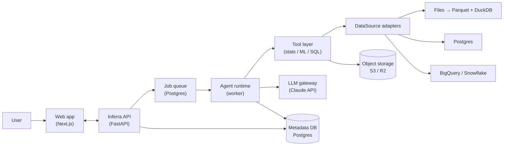
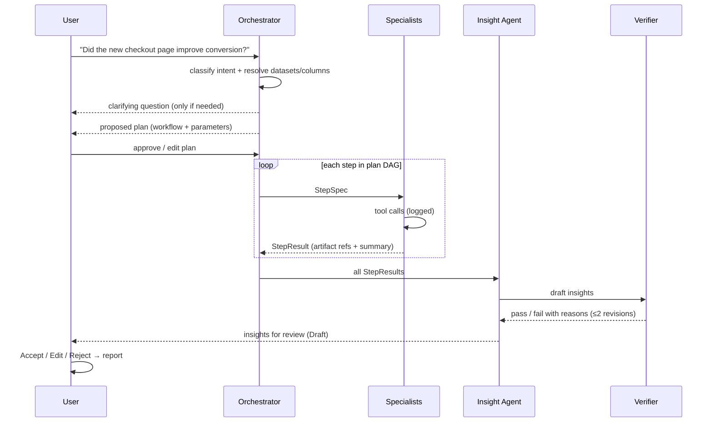
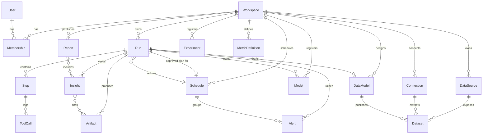

# Inferra — Architecture

This document describes how Inferra turns a natural-language goal into verified, reviewable data work using a small team of collaborating agents.

The guiding constraint: **multi-agent, but boring to reason about.** Every design choice below favors a structure that a new engineer can hold in their head.

## 1. Design principles

1. **Workflows are templates, not improvisation.** The planner picks and adapts a predefined workflow for the user's intent. It does not invent arbitrary pipelines.
2. **Hub and spoke.** Only the Orchestrator talks to specialist agents. Specialists never call each other.
3. **Agents share state through artifacts, not chat.** Every step reads and writes typed artifacts (tables, results, models) in a run-scoped store.
4. **LLMs reason; tools compute.** No number shown to a user is produced by a language model. Numbers come from deterministic tools (DuckDB, pandas, scipy, statsmodels, scikit-learn).
5. **Everything is reproducible.** Every tool call is logged with its inputs, code/SQL, and outputs, so any result can be re-run and audited.
6. **Humans review at fixed checkpoints.** Clarification, plan approval, and insight review. Nothing else blocks on a human.

## 2. System overview



Two deployables plus managed services:

| Component | Tech | Responsibility |
|---|---|---|
| `apps/web` | Next.js, TypeScript, Tailwind | UI only: goal input, plan review, live run view, insight review, dataset profiles. `/api/*` is proxied to the API so session cookies stay first-party |
| `services/api` | Python, FastAPI | REST + SSE API, auth, metadata, agent runtime (worker process), tool layer |
| Metadata DB | Postgres (Neon) | Workspaces, datasets, runs, steps, artifacts, insights, registries; also the job queue |
| Object storage | S3-compatible (Cloudflare R2; local disk in dev) | Uploaded files (normalized to Parquet), large artifacts, model binaries |
| LLM | Claude API via a thin gateway | Planning, tool selection, interpretation, narrative |

The API and the worker are the same Python codebase started in two modes (`api`, `worker`). This keeps the agent runtime next to the statistical and ML libraries it drives.

## 3. The agent team

Seven roles. Each specialist is just **a system prompt + an allowed tool set + a step contract.** No agent framework is required to understand them.

| Agent | Role | Example tools |
|---|---|---|
| **Orchestrator** | Understands the goal, asks clarifying questions, instantiates a workflow, dispatches steps, re-plans on failure | `classify_intent`, `list_datasets`, `instantiate_workflow` |
| **Data Agent** | Finds and checks data: schema discovery, profiling, keys and joins, data quality, SQL | `profile_dataset`, `run_sql` (read-only), `analyze_keys`, `find_relationships` |
| **Data Modeler** | Dimensional modeling: designs a star schema, writes the SQL transforms and tests, builds and fixes them | `analyze_keys`, `find_relationships`, `suggest_star_schema`, `build_data_model` |
| **Analyst Agent** | Descriptive and diagnostic analysis plus statistical modeling | `compute_metric`, `segment_breakdown`, `funnel`, `retention`, `decompose_metric_change`, `fit_regression`, `diff_in_diff`, `propensity_match`, `forecast` |
| **Experiment Agent** | A/B test design and analysis | `power_analysis`, `srm_check`, `ab_test`, `cuped_adjust`, `sequential_test`, `bayesian_ab`, `multiple_testing_correct` |
| **ML Agent** | Predictive modeling | `build_features`, `train_baseline`, `train_gbm`, `evaluate_model`, `explain_shap`, `write_model_card` |
| **Insight Agent** | Turns step results into claims with evidence; writes the readout | `draft_insights`, `request_verification` |

Plus one **non-LLM component**, the **Verifier**, which checks every drafted insight deterministically (see §6).

### Why this split

- Each specialist maps to a real job function (data engineer, analyst, experimentation scientist, ML engineer, and a lead who communicates findings), so the product story and the code structure match.
- Splitting by tool domain keeps each agent's tool list short (under ~12), which improves tool-selection accuracy and keeps prompts focused.
- Dataset catalogs in prompts list at most 40 columns per table, those sharing a word with the goal first; `list_tables` with a table and a search word finds the rest. Public datasets with hundreds of columns would otherwise crowd the prompt and dilute the plan.
- The Insight Agent is separate from the agents that produce results, so the one that writes the conclusion is not the one that ran the numbers. Together with the Verifier, this gives a built-in critic.

## 4. From natural language to a workflow



### 4.1 Intents and workflow templates

The Orchestrator classifies the goal into one intent and instantiates the matching template. Templates are versioned YAML/Python definitions in the repo.

| Intent | Example goal | Workflow template (steps → agent) |
|---|---|---|
| `explore` | "What's in this dataset?" | profile → Data · data-quality findings → Data · key distributions → Analyst · insights → Insight |
| `metric_query` | "Weekly revenue by region this quarter" | resolve metric + grain → Data · compute → Analyst · insights → Insight |
| `diagnose` | "Why did conversion drop last week?" | validate metric → Data · decompose change by dimensions → Analyst · check data issues → Data · insights → Insight |
| `experiment_design` | "How long should I run a test on the pricing page?" | baseline metric → Analyst · power analysis → Experiment · insights → Insight |
| `experiment_analysis` | "Did variant B win?" | locate assignment + metrics → Data · SRM + primary test + CUPED + guardrails + segments → Experiment · insights → Insight |
| `estimate_effect` | "Did the loyalty program increase spend?" (observational) | prepare panel → Data · DiD / PSM / regression → Analyst · insights (with causal caveats) → Insight |
| `predict` | "Predict which users will churn" | build features → Data · train + evaluate + explain → ML · insights + model card → Insight |
| `forecast` | "Forecast next month's orders" | prepare series → Data · forecast with intervals → Analyst · insights → Insight |
| `model_data` | "Turn these raw tables into an analytics model" | profile + grain, entities, joins → Data · design star schema, build, test, fix → Data Modeler · insights → Insight |
| `monitor` | "Alert me when conversion drops" | check freshness and volumes → Data · `check_metric` against the trailing baseline, decompose if it alerts → Analyst · insights → Insight; the completed run becomes a schedule |

The Orchestrator may add, drop, or parameterize steps within a template (for example, skip CUPED when no pre-period covariate exists), but it cannot create a step type that has no owning agent. If no intent fits with enough confidence, it asks the user rather than guessing. A step's task text marks optional clauses in brackets (`[ with CUPED on {covariate}]`); a clause whose parameters were not given drops out, so the plan never reads "not specified".

### 4.2 Plan format

A plan is a small DAG stored as JSON on the `Run`:

```json
{
  "intent": "experiment_analysis",
  "datasets": ["ds_checkout_events"],
  "params": { "variant_col": "variant", "primary_metric": "converted", "guardrails": ["revenue", "latency_ms"] },
  "steps": [
    { "id": "s1", "agent": "data", "task": "Validate assignment and metric columns", "depends_on": [] },
    { "id": "s2", "agent": "experiment", "task": "SRM, primary test, CUPED, guardrails, segments", "depends_on": ["s1"] },
    { "id": "s3", "agent": "insight", "task": "Experiment readout", "depends_on": ["s2"] }
  ]
}
```

The **executor that walks the DAG is plain code**, not an LLM. LLMs run only inside a step (specialists) or when re-planning after a failure.

### 4.3 Step contract

```text
StepSpec   = { run_id, step_id, agent, task, params, input_artifacts[] }
StepResult = { status: ok | failed | needs_input,
               artifacts[],          // refs into the artifact store
               summary,              // short natural-language note for the Orchestrator
               tool_calls[] }        // ids into the tool-call log
```

Guardrails per step: at most N tool calls (default 8), a timeout, and one automatic retry. On failure the Orchestrator either re-plans the remaining steps once or stops and reports what failed.

## 5. Tool layer

- Tools are **typed Python functions** with Pydantic input/output schemas. The same schema is exposed to the LLM as the tool definition.
- Every tool call is persisted as a `ToolCall` record: inputs, generated SQL/code, output artifact refs, duration, errors. This is the reproducibility log shown in the UI ("Show work").
- **No arbitrary code execution in the MVP.** Agents can only call typed tools plus **read-only SQL** against DuckDB or a connected warehouse. A sandboxed Python tool may be added later as an explicit escape hatch.
- Tools never call the LLM. That keeps the boundary clear: LLMs call tools, tools compute.
- Tools prefer principled defaults to judgment calls an agent would make ad hoc. For example, `ab_test` on a continuous metric also returns robust results (Mann-Whitney U, medians, means winsorized at the 1st/99th percentile) and the metric's skewness, so a heavy-tailed metric is read without hand-picked outlier cutoffs.

## 6. Insight Engine and verification

An **Insight** is the unit of output a human reviews:

```text
Insight = { claim,                // one sentence
            evidence[],           // artifact refs + the exact values cited
            method,               // e.g. "Welch t-test, CUPED-adjusted"
            checks[],             // verifier results
            confidence: high | medium | low,
            caveats[],
            recommended_action,
            status: draft | accepted | edited | rejected,
            reviewer, reviewed_at }
```

The **Verifier** is deterministic code that runs on every draft:

1. **Evidence.** Every citation must resolve to a value in an artifact, and the quoted value must match it.
2. **Number grounding.** Every number in the title, claim, caveats, and action must match a cited value at the precision shown (fractions may be written as percentages). Statistical conventions such as "95% CI" are exempt, but a stated threshold like "p < 0.001" must be true of a cited p-value.
3. **Causal language.** Causal wording ("caused", "drove", "led to") is allowed only when a cited artifact comes from a randomized design (with a passing sample ratio check) or an explicit causal method. Caveats may discuss causation freely.
4. **Sample size.** Fewer than 30 observations cannot support a high-confidence claim.
5. **Intervals.** A cited p-value, effect estimate, or forecast needs its interval from the same result.
6. **Multiple comparisons.** Segment results must cite Holm-adjusted p-values.
7. **Sample ratio.** An experiment that failed its SRM check can only appear as a low-confidence insight that discloses the broken assignment.
8. **Labels.** Numbers inside category labels of cited results (a version "5.2", a date) may be repeated without a citation; free text such as SQL is excluded.
9. **Assumptions.** Causal wording from an observational method (difference-in-differences, matching) needs a passing method check (parallel pre-trends, covariate balance) and a caveat naming the identifying assumption.
10. **Held-out metrics.** Model performance must be cited from holdout or cross-validation results, never training metrics; forecasts must be cited with their prediction interval.
11. **Model tests.** An insight citing a data model whose build has failing tests must say so in a caveat and cannot be high confidence.
12. **Alert status.** An insight citing a metric check must also cite the check's `status` (`alert` or `ok`), so a monitoring headline always rests on the tool's decision, not on prose.

The verifier checks that numbers are grounded and that the wording matches the strength of the evidence; it cannot judge whether the reasoning connecting them is right. That is what human review is for.

Failures go back to the Insight Agent with reasons (at most 2 revisions). Insights that still fail are shown to the reviewer flagged as **Unverified**, never silently dropped.

Only **accepted or edited** insights can be published into a report. This is checked when an insight is added and again on every publish, since a reviewer can reject an insight in between.

### Reports

A report is a title, a summary written by a person, and an ordered list of reviewed insights.
**Publishing** freezes a self-contained snapshot: the insights, every artifact they cite (so charts
render without the run), and an appendix with each source run's plan, step summaries, and the tool
and SQL behind each cited number. Edits after that show as "unpublished changes" until the next
publish. **Sharing** creates an unguessable token (`/r/{token}`); the public endpoint returns only
the published snapshot and needs no session, and revoking deletes the token so the link stops working
at once.

### Monitoring and scheduled re-runs

A **schedule** stores a copy of a plan a person approved, plus a cadence (daily, or weekly on a
weekday, at an hour in UTC). The worker checks for due schedules every 30 seconds and claims each one
with a compare-and-set update on `next_run_at`, so several workers never start the same run twice.
A scheduled run refreshes the plan's extracts and published data model nodes first (keeping the last
extract, and saying so, if a source is unreachable), then executes the same plan without
re-planning, so its results are comparable from week to week. Creating the schedule is the approval;
new insights still arrive as drafts for review.

The `monitor` workflow adds the decision. `check_metric` compares the latest complete day or week
with the median of the previous periods (a partial latest period is left out). It alerts only when
the change crosses the threshold in the watched direction **and** the value falls outside three
robust standard deviations (from the MAD), so normal noise does not page anyone and a shift that
began inside the baseline window does not hide itself. When a run completes, the executor raises an
**alert** for every metric check whose status is `alert`; nothing is inferred from prose. A completed
monitor run becomes its own schedule. Alerts show in the app (a badge on Monitors and a banner on the
run) until someone acknowledges them; email and Slack delivery are a possible later step. Demo
workspaces never fire, since their data is static.

## 7. Data access

```python
class DataSource(Protocol):
    def list_tables(self) -> list[TableInfo]: ...
    def query(self, sql: str, limit: int | None = None) -> QueryResult:  # one read-only SELECT
    def query_frame(self, sql: str) -> pd.DataFrame: ...                # for modeling tools
    def quote(self, identifier: str) -> str: ...
```

Every dataset, whatever its origin, is a Parquet file queried by a sandboxed in-process DuckDB
(single SELECT, file access limited to the workspace's directory, configuration locked). Tools never
see where data came from.

| Source | Phase | How it works |
|---|---|---|
| File upload | MVP | CSV/TSV/Parquet/Excel normalized to Parquet in object storage. With S3 storage the browser uploads to a presigned URL and the API ingests from the bucket, so large files skip the web proxy; otherwise (or without bucket CORS) a multipart upload |
| Postgres | Phase 3 | **Extracts.** A connection (password encrypted with a key derived from the app secret) pulls a table or a custom query into Parquet. Sessions are read-only (`default_transaction_read_only`) with a statement timeout; custom SQL runs as a subquery on a server-side cursor, which accepts exactly one SELECT. Private and loopback hosts are refused in production. Extracts refresh on demand. |
| BigQuery | Phase 4 | **Extracts** through a service account. Every query is dry-run first: it must be a SELECT, and the bytes it would scan must fit the connection's budget, which is also set as `maximum_bytes_billed` on the real job. |
| Snowflake | Phase 4 | **Extracts** with a password or key pair. Snowflake has no read-only session flag, so the connection should use a read-only role; on top of that custom SQL is wrapped as a subquery (rejecting DDL and DML), one statement per call, with a two-minute timeout. |

All three sit behind one connector interface (`datasources/connectors.py`: validate settings,
verify credentials, list tables, extract to Parquet), so a new warehouse is one module.

**Why extracts instead of live pushdown.** Live queries would require either translating every
tool's SQL into each warehouse dialect or loading DuckDB's network extensions at runtime. Extracts
keep one SQL dialect, one sandbox, and one tested code path for every tool, at the cost of freshness
(refresh is explicit and the extract records when it was taken) and a row cap (aggregate in the
source query for large tables). Live pushdown for aggregate-only tools is a possible later step.

### Metric layer

A metric is a structured definition, not free SQL: `sum`, `count`, `count_distinct`, `average`, or
`ratio` of two parts, plus an optional filter, time column, suggested dimensions, and display format.
Definitions are validated by computing them once, then passed to every run so agents compute
"conversion rate" exactly as the workspace defines it. The structure is what makes diagnosis exact:
a ratio's change between two periods splits into a **mix effect** (segment weights moved, measured
against the baseline average) and a **rate effect** (segment rates moved), and the pieces sum to the
total change for every dimension. Dimensions are ranked by how much more of the change their top
segment carries than its share of the volume.

### Data models (dimensional modeling)

A data model is a small dbt-style project: SQL nodes (staging, dimension, fact, mart) that read
datasets with `{{ source('table') }}` and each other with `{{ ref('node') }}`, plus column tests
(`unique`, `not_null`, `accepted_values`, `relationships`) and a grain per node.

- **Design.** `analyze_keys` finds a table's grain (single or minimal composite key, by a greedy
  search over identifier and dimension columns), exact duplicate rows, and entities. An attribute
  belongs to an entity when the entity determines it (a functional dependency, tolerating up to 2%
  violating entities, which are reported as attributes that change over time). Entities that
  determine other entities are transaction headers and stay on the fact; the rest become
  dimensions. `suggest_star_schema` turns that into a tested staging → dimensions + date dimension
  → fact project, which the Data Modeler agent (or a person) refines.
- **Build.** References compile to table names, nodes run in dependency order inside the same
  sandbox as every other query (each node must be one SELECT, and must declare every table it
  reads), and a failing node skips only its descendants. Tests run as SQL that returns the failing
  rows; the build records counts and samples.
- **Review and publish.** A run's build is saved as a draft data model. People edit nodes, rebuild,
  and publish chosen nodes as datasets (Parquet) that every other workflow can use; refreshing a
  published dataset rebuilds it from current sources.
- **Export.** A zipped dbt-duckdb project: one `.sql` per node, schema YAML with descriptions and
  tests, a bundled generic test for composite grains (no package downloads), and the source Parquet
  files. `dbt build` on the demo export reproduces Inferra's test results exactly.

## 8. Core data model



## 9. Runtime and operations

- **Schedules.** The worker loop also enqueues due scheduled re-runs (see §6), so production needs no separate cron.
- **Interrupted runs.** A restart, deploy, or a sleeping free-tier instance can stop a worker mid-run. On every tick the worker fails runs in `planning` or `running` that have made no progress for `INFERRA_RUN_STALL_MINUTES` (default 20; every model call and step counts as progress) and have no job still waiting in the queue. A late worker for such a run stops at its next step. People retry a failed run in one click: the approved plan is reused, or planning starts again if it failed there.
- **Jobs.** Planning and execution run as background jobs on a Postgres-backed queue (`SELECT … FOR UPDATE SKIP LOCKED`, no Redis). In development the API process runs the worker in a thread; in production it can run as a separate `python -m inferra.worker` process. While a run is active the UI polls its state; the append-only `run_events` table drives the activity timeline.
- **LLM gateway.** One module (`llm/gateway.py`) wraps the Claude API: the model comes from `INFERRA_LLM_MODEL`, effort is set per role (planning, specialist, insight), requests stream, prompts are cached, refusals fall back server-side, and token usage is accumulated per run. Agents depend on a small `LLMClient` protocol, so tests and the demo seed use a scripted client that drives the exact same pipeline. Per-workspace budgets are planned.
- **Auth.** GitHub OAuth plus a read-only demo workspace with seeded datasets and completed runs.
- **Limits.** Upload size, rows per query, tool calls per step, and who may spend the model budget: an optional allowlist of logins (`INFERRA_RUN_ALLOWLIST`) a cap on runs per person per UTC day (`INFERRA_DAILY_RUN_LIMIT`), and logins exempt from both (`INFERRA_RUN_UNLIMITED`), checked when a person or their schedule starts a run.
- **Observability.** Structured logs keyed by `run_id` / `step_id`; the run timeline in the UI is built from the same records.
- **Testing.** Tools are tested against reference implementations (pandas today; scipy/statsmodels as statistical tools land). End-to-end tests drive the full API → queue → agents → tools → verifier path with a scripted model, on SQLite and on Postgres in CI.

## 10. Repository layout

```text
inferra/
├─ apps/web/                  # Next.js UI
├─ services/api/
│  ├─ inferra/
│  │  ├─ api/                 # FastAPI routes and response schemas
│  │  ├─ auth/                # GitHub OAuth, signed-cookie sessions, workspace roles
│  │  ├─ agents/              # orchestrator.py, specialist.py (Data, Analyst, Experiment, ML, Modeler), insight.py, prompts.py
│  │  ├─ workflows/           # intent templates
│  │  ├─ runtime/             # job queue, run executor, scheduler and alerts, quota, recovery, recorder
│  │  ├─ tools/               # typed tools: profiling, SQL, metrics, experiments, modeling, ml, datamodel
│  │  ├─ transform/           # data models: compile, build + tests, star-schema design, dbt export
│  │  ├─ metrics_layer.py     # metric definitions -> tool specs
│  │  ├─ verify/              # deterministic insight verifier
│  │  ├─ datasources/         # DataSource protocol, sandboxed DuckDB source, Postgres/BigQuery/Snowflake extracts
│  │  ├─ llm/                 # Claude gateway, scripted client, demo script
│  │  ├─ db/                  # SQLAlchemy models and sessions
│  │  └─ seed.py              # demo workspace
│  ├─ migrations/             # Alembic
│  └─ tests/
├─ samples/                   # demo datasets (scripts/generate_samples.py)
└─ docs/
```
